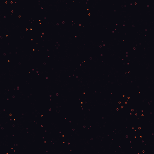

# Life Art

**Conway and cellular-automata GIF/PNG poster generator with a compiled Mojo core — 23,000 generations/s on a 256×256 grid, 1650× faster than the same automaton in pure Python.**

A Life run is normally a black-and-white animation. This one colours every cell by *how long it has been
alive*, so the picture is a record of lineage: the oldest surviving structures burn brightest and everything
that died young stays near the background. The evolution is a compiled Mojo kernel; the PNG, GIF and text
encoders are ~200 lines of deterministic Python you can read in one sitting.

```
+----------------+--------------------------------------------+
|  M O J O   a p p |  L I F E   A R T       b3 / s23   seed 4242 |
+----------------+--------------------------------------------+
```

---

## 30-second quickstart

```bash
pixi install

# build the shared library (~5 s) and run the tests
pixi run build
pixi run test

# a poster, an animation and a text card into demo/out/
pixi run demo
```

Then, without the demo script:

```bash
# a 256x256 PNG after 220 generations
pixi run python -m mojoapp_life_art poster --seed 4242 --density 0.36 --gens 220 -o poster.png

# a 160x160 animated GIF, 90 frames
pixi run python -m mojoapp_life_art gif --width 160 --height 160 --gens 178 --stride 2 -o life.gif

# the same automaton as a terminal card
pixi run python -m mojoapp_life_art ascii --width 72 --height 28 --seed 404 --density 0.40 --gens 90
```

As a library:

```python
from mojoapp_life_art import Simulation

sim = Simulation(512, 512)
sim.randomize(seed=7, density=0.3)
sim.run(300)                       # 300 generations, one FFI call
rgb, idx = sim.render("ember")     # (h, w, 3) uint8 and (h, w) palette indices
print(sim.population(), sim.max_age())
```

---

## What it makes

`pixi run demo` writes four artifacts into `demo/out/`, all under 2 MB, all reproducible from their seeds:

| file | what it is | size |
| --- | --- | ---: |
| `demo/out/poster.png` | 256×256 still, 220 generations, `ember` palette, seed 4242 | 10.6 KiB |
| `demo/out/life.gif` | 160×160 animated GIF, 90 frames every 2 generations, `ice`, seed 20260915 | 291.6 KiB |
| `demo/out/card.txt` | 72×28 terminal card, `terminal` palette, seed 404 | 2.3 KiB |
| `demo/out/stats.json` | the parameters behind all three plus the measured timings | 1.0 KiB |



The text card, verbatim from `demo/out/card.txt`:

```
life-art  conway (B3/S23)  72x28  gens=90  seed=404  density=0.4
+------------------------------------------------------------------------+
|               .                                                        |
|                  .                                                     |
|                                                  .                     |
|                                               .     .                  |
|                                                             .          |
|                                                           .  .         |
|                                                            ..          |
|                                                       ..               |
|                                                        .               |
|                    ::                                                  |
|                    ::                                                  |
+------------------------------------------------------------------------+
population 284   max age 61   palette terminal
```

---

## Benchmarks

Everything below is measured by `bench/bench.py` on the machine that ran it, in one process, with
compilation outside every timed region. `pixi run bench` prints two tables.

### Compiled Mojo vs pure Python

The baseline is `mojoapp_life_art.reference` — the same automaton written the obvious way, with flat
lists and an explicit neighbour loop. It is also the correctness oracle in `tests/test_parity.py`, so
these rows are comparing something that is known to be right against something claimed to be.

Machine: Intel Xeon E5-2697 v4 @ 2.30 GHz, Python 3.13.15, numpy 2.5.3. Best of 5 after 2 warm-ups.

| case | rule | cells | gens | Mojo | gens/s | pure Python | speedup | parity |
| --- | --- | ---: | ---: | ---: | ---: | ---: | ---: | :---: |
| 256x256 x20 | conway | 65,536 | 20 | 1.040 ms | 19,228 | 1731.6 ms | **1664.70x** | exact |
| 512x512 x10 | conway | 262,144 | 10 | 1.811 ms | 5,521 | 3931.3 ms | **2170.65x** | exact |
| 256x256 x50 | conway | 65,536 | 50 | 3.089 ms | 16,185 | 4445.5 ms | **1439.02x** | exact |
| 512x512 x20 | seeds | 262,144 | 20 | 10.917 ms | 1,832 | 7996.4 ms | **732.46x** | exact |
| 256x256 x30 | daynight | 65,536 | 30 | 4.812 ms | 6,235 | 2549.9 ms | **529.95x** | exact |
| 1024x1024 x10 | conway | 1,048,576 | 10 | 7.305 ms | 1,369 | 16599.7 ms | **2272.42x** | exact |
| 16x16 x5 | conway | 256 | 5 | 0.013 ms | 378,015 | 1.6 ms | **120.24x** | exact |
| 32x32 x5 | conway | 1,024 | 5 | 0.026 ms | 192,968 | 7.0 ms | **269.28x** | exact |
| 64x64 x10 | conway | 4,096 | 10 | 0.088 ms | 113,825 | 53.0 ms | **603.50x** | exact |

`parity exact` means the two implementations' final grids are equal cell for cell, not merely their
populations. Both sides start from the same deterministic seed, run the same number of generations under
the same rule, and the comparison is on the grid, at the end.

The `seeds` row is the interesting one: `B2/S` has no survival cases at all, so every cell is a birth.
Measured on the serial path that is **3.2× slower than Conway** at the same size (197 µs/gen vs
61 µs/gen at 256×256), and the reason is structural: Conway gets a special-cased fast path of two
saturating threshold comparisons, while `seeds` runs the general body, which evaluates all nine
neighbour counts through the threshold pair twice each. That cost is the price of supporting any of the
8 named rules — or any other pair of 9-bit masks — without a special case per rule.

### Serial vs parallel, and why the threshold is measured

The rule engine is SIMD-vectorised and has a `parallelize` path. Whether the parallel path is *worth* using
is not a property of the source, it is a property of the machine: a `parallelize` launch costs a fixed
amount per generation, and on a contended host that cost can exceed a whole generation of work.

`Simulation.calibrate()` measures both on the host it is running on and caches the result:

| shape | cells | serial µs/gen | parallel µs/gen | parallel speedup | winner |
| --- | ---: | ---: | ---: | ---: | :---: |
| 512x512 | 262,144 | 162 | 172 | 0.94x | serial |
| 1024x1024 | 1,048,576 | 700 | 586 | 1.19x | parallel |
| 2048x2048 | 4,194,304 | 2462 | 2604 | 0.95x | serial |
| 4096x4096 | 16,777,216 | 14855 | 23667 | 0.63x | serial |

The headline honest finding: **on this host the parallel path is not reliably faster, and at the largest
size measured it is 37% slower.** The machine runs a load average above its 72 cores, so spawning workers
costs more than the work they do. Three of four sizes are faster without the launch.

So there is no hard-coded threshold. The kernel has a floor (`PAR_MIN_CELLS = 262144`) below which it will
not parallelise regardless, and above that the Python side measures the break-even on the actual machine
before deciding. Both paths are asserted cell-for-cell identical in `tests/test_parity.py`, so the choice
changes how long a run takes, never what it produces. `Simulation(w, h, workers=1)` forces the serial
path and `workers=N` forces N, which is how the table above is produced.

What you see in the headline table therefore depends on the host. The 1024×1024 row reads 181 gens/s on a
run where the load average was 80, and 1,369 gens/s on a quieter one — a 7.5× swing in *both* columns,
because both were slow. The speedup ratio against the reference is far more stable than either absolute
number, which is why it is the number quoted at the top.

---

## How it works

```
src/ported.mojo      kernels: evolve, render, seed, reduce, blit
src/capi.mojo        the C ABI, and the only file with Mojo dialect details
dist/*.so            built by build/build.sh, called through ctypes
python/              Simulation object, encoders, palettes, CLI
tests/               126 tests: parity, API, goldens, scheduling
bench/bench.py       the two tables above
demo/make_demo.py    the four artifacts
showcase/            mojosub and mojojojo demos
```

**The grid.** `w*h` `UInt8` cells, row-major, each 0 or 1, with **toroidal** wrap in both axes. Toroidal
is a deliberate choice, not a convenience: row `y` only ever reads rows `y-1`, `y` and `y+1`, so every row
is an independent work item and the parallel path needs no barrier and no halo exchange.

**The kernel.** One generation is 9 neighbour loads, a rule, and an age update per cell. The vector body
runs 32 lanes at a time (`simd_width_of[DType.uint8]()`, 32 on this host, queried through the ABI rather
than restated in Python). Conway's `B3/S23` is special-cased — it is the one rule where the vector body can
skip a nine-way unrolled table and use two saturating threshold comparisons. Every other totalistic rule
runs the general body, which is correct for any 9-bit birth/survive mask pair.

**The age buffer.** Every cell carries how many consecutive generations it has been alive, saturating at
255. `old + 1` on a `UInt8` would wrap 255 to 0 and make an ancient cell look newborn, so the clamp is
inside the kernel and not at the palette lookup. This buffer is the whole reason the output is a poster.

**The rule encoding.** A rule is two 9-bit masks: bit `k` of `birth` means "a dead cell with `k` live
neighbours is born", bit `k` of `survive` means "a live cell with `k` live neighbours survives". Conway is
`B3/S23`. Eight rules ship by name (`conway`, `highlife`, `daynight`, `seeds`, `maze`, `coral`,
`replicator`, `2x2`), and any pair of masks works.

**The encoders are hand-rolled on purpose.** `png.py` and `gif.py` are ~230 lines total, and the reason is
testability: `tests/test_golden.py` pins three SHA-256 digests, so a Pillow or zlib upgrade cannot change a
test outcome or a published artifact. The GIF encoder includes a from-scratch GIF-flavoured LZW with a
12-bit dictionary and clear-code reset; it is checked against Pillow's decoder in `tests/test_api.py` and
against fixed bytes in `tests/test_golden.py`.

**Buffers cross the ABI as `Int` addresses.** `@export` rejects parametric functions and Mojo pointers are
non-nullable, so each wrapper takes an address and rebuilds a `Pointer[UInt8, AnyOrigin[mut=True]]` inside
the branch that uses it. The caller owns every buffer, including the ping-pong pairs, so nothing in the
kernel allocates and nothing can leak.

---

## Parity, and what is actually verified

`reference.Reference` is the specification: flat lists, explicit neighbour loops, no tricks. It is the same
algorithm the Mojo kernel runs, and `tests/test_parity.py` asserts they agree cell for cell:

* all 8 named rules, at two grid sizes, 6 generations each
* widths either side of the SIMD width and of the parallel floor — the two boundaries where the vector
  tail, the wrapped edge columns and the serial/parallel switch actually live
* seeds across the full density range including the 0.0 and 1.0 extremes
* 50 generations on two rules, so a bug that only shows once a run settles (an age that never saturates)
  cannot pass
* `run(gens)` against `gens` separate `step()` calls, against the reference, for odd and even counts

Plus structural assertions that do not depend on the reference at all: a glider translates by exactly one
cell per four generations, a block is still life, a blinker has period 2, and ages saturate at 255.

```
126 passed
```

---

## Showcases

Both optional SDKs are **not on PyPI** (verified: `pypi.org/pypi/mojosub/json` and
`pypi.org/pypi/mojojojo/json` both 404), so they are not declared in `pixi.toml`. Both scripts import them
through a guard that skips with a message naming the fix, and neither prints a number it did not measure.

`showcase/mojosub.py` takes the age→palette-index→RGB loop from `_render_row`, writes it as plain Python,
and times it under `@jit` against CPython. The point it makes is that the distance between "this loop is
slow" and "this loop is native" is one decorator:

```
$ pixi run showcase
skip: the `mojosub` package is not importable.
  It is not on PyPI -- it ships from https://github.com/lee101/mojosub.
  Either clone it and point this script at the checkout:
      export MOJOSUB_PATH=/path/to/mojosub
  ...
  Nothing was compiled and no speedup is claimed.
```

`showcase/mojojojo.py` ships the reference step loop verbatim into a remote run on
https://mojojojo.cc and asserts the remote population equals the local one. The point is agreement, not
speed: if the two grids ever diverge, the platform changed something underneath us. It needs
`MOJOJOJO_KEY` and skips cleanly without one.

---

## Layout and tasks

```
pixi run build      # src/*.mojo -> dist/libmojoapp-life-art.so
pixi run test       # pytest
pixi run bench      # the two tables above (serialised on /tmp/mojo-bench.lock)
pixi run demo       # demo/out/
pixi run showcase   # showcase/mojosub.py
```

`build/build.sh` is the only build path. It builds `src/capi.mojo` as a single compilation unit — build
cost here is a flat 2–5 s regardless of how many functions the unit holds, so batching is worth far more
than splitting. `MODULAR_HOME` is derived from the resolved `mojo` binary when `pixi run` has not set it,
because without it every `std` import fails with `unable to locate module 'std'`.

## Requirements

Mojo `1.2.0.dev2026092905` and `max` `26.7.0.dev2026092905` (pinned in `pixi.toml`; `max` ships
`max.algorithm.parallelize` and is not optional). Python 3.13, numpy, Pillow — Pillow is test-only: the
encoders do not use it.

## Licence

MIT. See `LICENSE`.